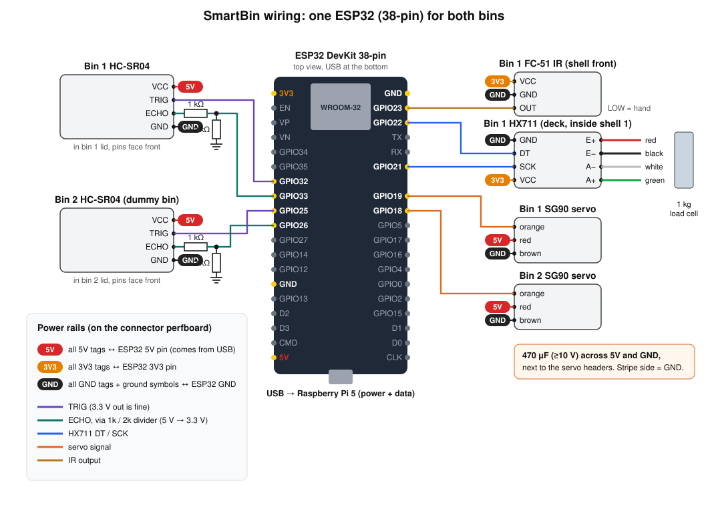

# Wiring guide

[← Home](index.md) · Next: [Raspberry Pi setup](pi-setup.md)

This is the current build: **one ESP32 DevKit (38-pin)** drives both bins and connects to the **Raspberry Pi 5** by USB.

| | Bin 1 (LEFT) | Bin 2 (RIGHT, dummy) |
|---|---|---|
| HC-SR04 ultrasonic (fill level) | yes | yes |
| SG90 servo (lid) | yes | yes |
| 1 kg load cell + HX711 (weight) | yes | **no** |
| FC-51 IR (hand → open lid) | yes | **no** |

Bin 2's lid opens only from the dashboard or `binctl open 2`. Its weight is always reported as "no load cell".

> **Already wired bin 1 on other pins?** Either rewire to the table below, or change the pin numbers in
> [`firmware/src/config.h`](https://github.com/VishalRamKN/smartbin/blob/main/firmware/src/config.h) and reflash. The code and this page must agree.



---

## 1. Master pin table

The labels printed on your ESP32 are what count. Most 38-pin boards print `D32` or `G32` or just `32` for GPIO32.

| ESP32 pin | Goes to | Wire | Notes |
|---|---|---|---|
| **GPIO32** | Bin 1 HC-SR04 **TRIG** | direct | 3.3 V is enough to trigger the HC-SR04 |
| **GPIO33** | Bin 1 HC-SR04 **ECHO** | **via 1 kΩ / 2 kΩ divider** | ECHO outputs 5 V, which would damage the ESP32 without the divider |
| **GPIO25** | Bin 2 HC-SR04 **TRIG** | direct | |
| **GPIO26** | Bin 2 HC-SR04 **ECHO** | **via 1 kΩ / 2 kΩ divider** | second, separate divider |
| **GPIO22** | HX711 **DT** (DOUT) | direct | |
| **GPIO21** | HX711 **SCK** (PD_SCK) | direct | |
| **GPIO23** | FC-51 IR **OUT** | direct | LOW when a hand is in front |
| **GPIO19** | Bin 1 SG90 **signal** (orange) | direct | |
| **GPIO18** | Bin 2 SG90 **signal** (orange) | direct | |
| **5V** | 5 V rail: both HC-SR04 VCC, both servo red wires, 470 µF + | | 5 V from the Pi's USB port, through the board's diode |
| **3V3** | 3.3 V rail: HX711 VCC, FC-51 VCC | | |
| **GND** | GND rail: every module GND, servo brown wires, both 2 kΩ resistors, 470 µF − | | use both GND pins if convenient |
| USB port | Raspberry Pi 5 USB port | data cable | power + serial. No other power supply. |

Pins avoided on purpose: GPIO 0, 2, 5, 12, 15 (boot strapping), 6–11 (flash memory), 1/3 (USB serial). GPIO2 is the on-board LED, which the firmware lights while a lid is open.

## 2. Why some modules get 3.3 V and some 5 V

- **HC-SR04 must have 5 V** to work. Its ECHO output is therefore 5 V, so it goes through the divider: `5 V × 2k / (1k + 2k) = 3.33 V`.
  If you have an **HC-SR04P or RCWL-1601**, power it from 3V3 instead and skip the divider.
- **HX711 on 3V3**: its DT output then swings 0–3.3 V, which is safe for the ESP32. (If your HX711 board has separate **VDD** and **VCC** pins, put VDD on 3V3 and VCC on 5V.)
- **FC-51 on 3V3**: the module works from 3.3 to 5 V. On 3V3 its OUT pin can never exceed 3.3 V.
- **Servos on 5V**: they need it for torque. Their signal wire takes 3.3 V logic without problems.

Divider values that also work: 10 kΩ + 20 kΩ, 1 kΩ + 2.2 kΩ (3.4 V), or 2 × 1 kΩ in series for the "2 kΩ".
**Never** swap the two resistors: 1 kΩ goes from ECHO to the GPIO, and 2 kΩ goes from the GPIO to GND.

## 3. Module by module

### Bin 1 and bin 2 HC-SR04 (in each lid, header facing the front)

| HC-SR04 pin | Bin 1 | Bin 2 |
|---|---|---|
| VCC | 5V rail | 5V rail |
| TRIG | GPIO32 | GPIO25 |
| ECHO | 1 kΩ → **GPIO33**, with 2 kΩ from GPIO33 to GND | 1 kΩ → **GPIO26**, with 2 kΩ from GPIO26 to GND |
| GND | GND rail | GND rail |

The sensor sits in the lid, so **its wires bend every time the lid opens**. Leave a loose loop of about 4–5 cm at the hinge side, and zip-tie the bundle to the slots on the back of the shell **after** that loop. Open the lid by hand all the way to check that nothing pulls tight.

### HX711 + 1 kg load cell (bin 1 only)

Load cell to HX711 (the usual colour code, also printed on most HX711 boards):

| Load cell wire | HX711 pin |
|---|---|
| Red | E+ |
| Black | E− |
| White | A− |
| Green | A+ |

HX711 to the ESP32:

| HX711 pin | Connect to |
|---|---|
| GND | GND rail |
| DT | GPIO22 |
| SCK | GPIO21 |
| VCC | 3V3 rail |

- If the weight goes **down** when you press the pan, that's fine: the calibration step works out the sign. (Swapping white and green flips it, if you prefer.)
- Solder the thin load-cell wires to the HX711 rather than using Dupont pins. Put heat-shrink on each joint. A loose joint here shows up as a weight that jumps around.
- Keep the HX711 wires **away from the servo wires**. Twist the four HX711 → ESP32 wires loosely together.

### FC-51 IR hand sensor (bin 1 only, on the shell front rails, LEDs up)

| FC-51 pin | Connect to |
|---|---|
| VCC | 3V3 rail |
| GND | GND rail |
| OUT | GPIO23 |

Turn the blue trimmer on the module so its second LED turns on with your hand about **5–8 cm** in front of it, and stays off for people walking past.

### SG90 servos (behind each bin)

| SG90 wire | Bin 1 | Bin 2 |
|---|---|---|
| Orange (signal) | GPIO19 | GPIO18 |
| Red (+5 V) | 5V rail | 5V rail |
| Brown (GND) | GND rail | GND rail |

Put the **470 µF capacitor** across the 5V and GND rails, close to where the servo plugs connect. The stripe on the can marks the **negative (GND)** leg. Without it, a servo starting up can pull the 5 V line down far enough to reset the ESP32.

The firmware moves only one lid at a time and slowly, and switches a servo off once its lid has closed. Together with the capacitor, this keeps everything within what one Pi USB port supplies.

## 4. Building it on perfboard (the v2 tray)

The v2 tray has two 3 × 7 cm perfboard cradles, which were meant for two ESP32s. With one ESP32, use them like this:

**Board A: ESP32 socket.** Solder two **19-pin female header** strips (cut them from 40-pin strips) so the ESP32 plugs in and stays removable. Leave the USB end at the edge facing the Pi's USB ports.

**Board B: connector board.** It holds the three rails, both dividers, the capacitor and the sensor headers:

```
 Board B (3 x 7 cm), top view                       male header pins, 2.54 mm
 ┌──────────────────────────────────────────────────────────────┐
 │ 5V  rail  ════════════════════════════════════════════════   │ ← red wire from ESP32 5V
 │ 3V3 rail  ════════════════════════════════════════════════   │ ← orange wire from ESP32 3V3
 │ GND rail  ════════════════════════════════════════════════   │ ← black wire from ESP32 GND
 │                                                              │
 │ J1 US1  [5V][TRIG][ECHO][GND]   R1 1k: ECHO→node1, R2 2k: node1→GND, node1 → GPIO33
 │ J2 US2  [5V][TRIG][ECHO][GND]   R3 1k: ECHO→node2, R4 2k: node2→GND, node2 → GPIO26
 │ J3 SRV1 [SIG][5V][GND]          C1 470 µF across 5V/GND, next to J3/J4
 │ J4 SRV2 [SIG][5V][GND]
 │ J5 IR   [VCC=3V3][GND][OUT]
 │ J6 HX   [GND][DT][SCK][VCC=3V3]
 └──────────────────────────────────────────────────────────────┘
```

The header pin order matches each module's own pin order, so a straight 4- or 3-wire Dupont lead plugs in without crossing wires. SG90 plugs are brown-red-orange: plug them in with **orange on SIG**.

Board B to Board A: 3 power wires (5V, 3V3, GND) plus 9 signal wires (GPIO32, 33, 25, 26, 22, 21, 23, 19, 18). Use short solid hookup wire, and colour-code it if you can: red 5 V, orange 3V3, black GND.

**No perfboard yet?** You can test everything on a breadboard first. The pin table doesn't change.

## 5. Checks before the first power-up

Do these with the **USB cable unplugged**:

1. **No short:** multimeter in continuity mode between the 5V rail and GND, then between 3V3 and GND. It must **not** beep. (With the capacitor fitted, the meter may beep briefly while the capacitor charges, then stop. That's fine.)
2. **Each divider:** resistance from GPIO33 to GND ≈ 2 kΩ, and from the HC-SR04 ECHO header pin to GPIO33 ≈ 1 kΩ. The same for GPIO26.
3. **Capacitor polarity:** the stripe goes to GND.
4. **Nothing on the 5V rail reaches a GPIO.** Check the two TRIG wires, DT, SCK, OUT and the two servo signal wires against the table one more time.

## 6. Bring it up one module at a time

Do this after the [Pi setup](pi-setup.md) and the first flash, so the firmware is already running. **Unplug the USB cable before you add each module**, then plug it back in.

| Step | Connect | Check with | Expected |
|---|---|---|---|
| 1 | Nothing, bare ESP32 | `binctl state` | both bins listed, distance `--`, status `NO_READING` |
| 2 | HX711 + load cell | `binctl info` then `binctl raw` | `hx_alive` true. Run `raw` twice, pressing the pan the second time: the number changes a lot |
| 3 | Bin 1 HC-SR04 | `binctl watch` | bin 1 distance ≈ 80 mm with the empty bucket and the lid closed. Paper in the bucket makes it shorter |
| 4 | Bin 2 HC-SR04 | `binctl watch` | the same for bin 2 |
| 5 | Both servos | `binctl servo 1 30`, `binctl servo 2 30` | each servo moves when you send its command |
| 6 | IR sensor | wave a hand | bin 1 lid opens and closes 3 s after the hand leaves |

If a step fails, see [troubleshooting](pi-setup.md#troubleshooting). Then go on to [calibration](calibration.md): lid angles, tare and the load-cell scale.
